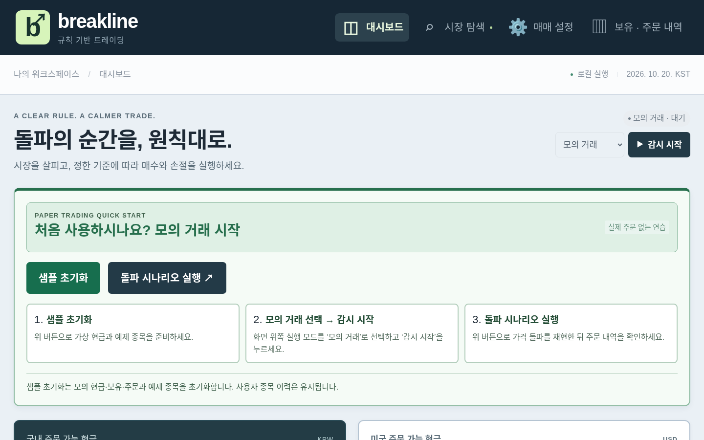

# Breakline · 키움 최고가 돌파 매매

국내·미국 주식과 ETF를 검색하고, 설정 화면에서 입력한 **최고가 돌파율·매입 비율·손절률**로 매매하는 로컬 웹 프로그램입니다. 기본 대상 범위는 **전체 시장 자동 검색**이며, 처음 실행하면 실제 주문을 보내지 않는 모의 모드의 정지 상태로 시작합니다.

키움 공식 REST API의 국내·미국 주식 기능과 실시간 체결 구독 어댑터를 구현했습니다. 실제 계좌 인증, 전체 시장 구독 허용 범위, 실제 주문·체결은 사용자 API 키와 권한으로 추가 검증해야 합니다. 키 없는 예제 실행과 모의 응답 테스트의 성공이 실거래 검증을 뜻하지는 않습니다.



## 구현된 동작

| 항목 | 동작 |
| --- | --- |
| 검색 대상 | 키움이 반환한 KOSPI·KOSDAQ·ETF, 미국 ND·NY·NA 거래소의 주식·ETF 목록. 미국 ETN은 제외 |
| 최고가 | 각 시장의 전 거래일까지 완료된 상장 이후 수정 일봉 최고가. 오늘 일봉은 제외 |
| 매수 | 직전 관측값이 기준선 미만이고 새 가격이 기준선 이상인 **상향 돌파**에서 주문 |
| 매입 비율 | 해당 주문 시점의 남은 주문 가능 현금에 적용. 수수료 여유금과 미체결 예약금 반영 |
| 통화 | 국내 KRW와 미국 USD를 분리. 원화 자동 환전이나 달러 대신 원화로 주문하는 기능 없음 |
| 손절 | 실제 체결 평균가 기준의 손절선 이하에서 해당 종목 전량 매도 주문 |
| 추가 설정 | 종목별 추가 매수, 손절 후 재매수 대기시간, 최대 보유 종목 수, 수수료 여유율 |
| 복구 | 설정·주문·부분 체결·잔고를 로컬 SQLite에 저장. 재실행 시 항상 정지, 새 첫 시세로 기준 관측값 초기화 |

돌파율 `-2%`도 입력할 수 있습니다. 역대 최고가가 10,000원이면 기준선은 9,800원이며, 가격이 그 선 **아래에서 위로 넘어올 때** 매수합니다. 처음 본 가격이 이미 기준선 위에 있다고 바로 매수하지 않습니다.

## 설치와 실행

Python **3.11~3.13**과 [uv](https://docs.astral.sh/uv/getting-started/installation/)가 필요합니다. 아래 명령은 저장소 최상위 폴더에서 실행합니다. 기존 `.env`는 덮어쓰지 않습니다.

Linux / macOS:

```bash
git clone https://github.com/roy888682/kiwoom_buy_sell.git
cd kiwoom_buy_sell
uv sync --frozen
[ -f .env ] || cp .env.example .env
uv run uvicorn app.main:app --host 127.0.0.1 --port 8000
```

Windows PowerShell:

```powershell
git clone https://github.com/roy888682/kiwoom_buy_sell.git
Set-Location kiwoom_buy_sell
uv sync --frozen
if (!(Test-Path .env)) { Copy-Item .env.example .env }
uv run uvicorn app.main:app --host 127.0.0.1 --port 8000
```

자신의 PC에서 실행한 경우 브라우저 주소창에 `127.0.0.1:8000`을 입력합니다. 서버는 실행한 터미널에서 계속 동작해야 합니다. API 키를 입력하거나 변경했다면 서버를 다시 시작하세요.

Brave에서도 새 탭의 주소창에 `http://127.0.0.1:8000`을 직접 입력하면 됩니다. 채팅 안의 웹 미리보기와 별도로 열리며, `F11`로 전체 화면을 사용할 수 있습니다. 화면 글자는 초기 화면의 1.6배(직전 확대 화면의 80%)를 기본으로 사용하며, 각 영역은 배경색과 테두리로 구분합니다. **샘플 초기화**와 **돌파 시나리오 실행**은 화면 상단의 초록색 모의 거래 안내 영역에 있습니다.

이 프로그램에는 사용자 로그인 기능이 없습니다. `127.0.0.1` 바인딩을 유지하고 공개 서버나 외부 포트로 노출하지 마세요. 계정 한 곳에 서버 프로세스 하나만 실행하며, 여러 uvicorn worker를 사용하지 않습니다.

## 키 없이 먼저 확인하기

1. 대시보드의 **샘플 초기화**를 누릅니다. 모의 현금은 KRW 1,000만 원, USD 1만 달러입니다.
2. 돌파율 `2`, 매입 비율 `30`, 손절률 `5`를 확인하고 설정을 저장합니다.
3. **모의 거래 → 감시 시작 → 돌파 시나리오 실행**을 누릅니다.
4. 국내·미국 가상 종목의 매수, 통화별 잔액, 실제로 적용한 모의 체결 평균가와 손절선을 확인합니다.
5. 감시 종목의 모의 가격 입력으로 손절선 이하 가격을 보내 전량 매도 흐름을 확인할 수 있습니다.

샘플은 가격 규칙을 확인하는 가상 자료입니다. 전체 시장 검색 결과나 키움 모의투자 체결 자료가 아닙니다. 모의 체결은 입력 가격에서 즉시 체결된 것으로 가정하며, 설정한 수수료 여유율을 모의 수수료로 사용합니다.

## 키움 연결과 전체 시장 검색

연결 순서, 환경 변수, 미국 시세 시간대 확인, 주문 대조 방법은 **[키움 연결 안내](docs/kiwoom-connection.md)**에 있습니다. 계산식·예외 처리·CSV 형식은 **[매매 규칙](docs/strategy.md)**을 참고하세요.

키가 연결되면 전체 종목 목록을 가져와 상장 이후 수정 일봉을 검증합니다. 초기 준비는 종목 수와 이력 길이에 따라 오래 걸립니다. REST 요청은 기본적으로 최소 0.25초 간격으로 직렬 처리하고, 보유 잔고·주문 조회도 같은 제한을 공유합니다. 일봉 준비가 끝나면 적격 종목과 보유 종목에 국내 `0B`·미국 `FE` 실시간 구독을 요청합니다.

전체 목록을 받았다는 사실만으로 전체 시장의 모든 틱을 받는다고 표시하지 않습니다. 제공 이력, 미국 상장일, 시세 권한, 구독 승인 종목 수를 확인해야 합니다. 이력이 부족한 종목은 매수하지 않으며, 구독 거절·연결 공백·처리 대기열 초과 시 자동매매를 정지합니다. 구독 승인 후 첫 시세는 새 기준 관측값으로 사용합니다.

## 실거래 전 확인할 점

- 실거래 시작 시 계좌의 기존 현금 보유 종목도 가져오며 **그 종목들에도 손절 규칙이 적용됩니다.** 별도 계좌 사용을 권장합니다.
- 감시 중지는 새 매매 판단과 손절 감시를 모두 멈춥니다. 이미 키움에 접수된 미체결 주문은 자동 취소되지 않습니다.
- 손절률은 주문을 내는 기준입니다. 급락, 호가 공백, 거래정지, 장 마감, 체결 지연 시 실제 손실은 설정값보다 커질 수 있습니다.
- 프로그램 실행 중 다른 HTS·MTS에서 수동 거래하면 잔고 대조 오류로 자동매매가 정지할 수 있습니다.
- 이 버전은 실제 계좌·시장 데이터로 장기 운영 검증을 마친 배포 제품이나 수익을 보장하는 전략이 아닙니다. 먼저 모의 실행과 조회 권한을 확인하세요.

## 개발과 검증

```bash
uv run python -m unittest discover -s tests -v
```

테스트는 돌파·음수 돌파율·현금 배분·예약금·부분 체결·손절·재매수 대기, 거래소 휴일, CSV 이력 검증, HTTP와 실시간 시세 프로토콜의 모의 응답, 애플리케이션 API를 검사합니다. 실제 인증이나 실제 주문은 테스트에서 실행하지 않습니다.

| 파일 | 역할 |
| --- | --- |
| `app/main.py` | 로컬 API, 검색·실시간 감시·주문 조정 |
| `app/strategy.py` | Decimal 기반 매매 규칙과 누적 체결 장부 |
| `app/marketdata.py` | 거래일·정규장·수정 최고가·CSV 검증 |
| `app/kiwoom.py` | 키움 OAuth·조회·주문 REST 어댑터 |
| `app/stream.py` | 실시간 구독 승인·체결 수신·공백 감지 |
| `app/storage.py`, `data/` | 로컬 SQLite 상태 저장; `data/`는 Git 제외 |
| `app/static/` | 설정·검색·계좌·주문 화면 |

API 키는 `.env` 또는 실행 환경의 비밀 값으로만 설정합니다. `.env`, 계좌 DB, 토큰을 GitHub나 채팅에 올리지 마세요. 저장소에는 값이 비어 있는 `.env.example`만 포함합니다.
