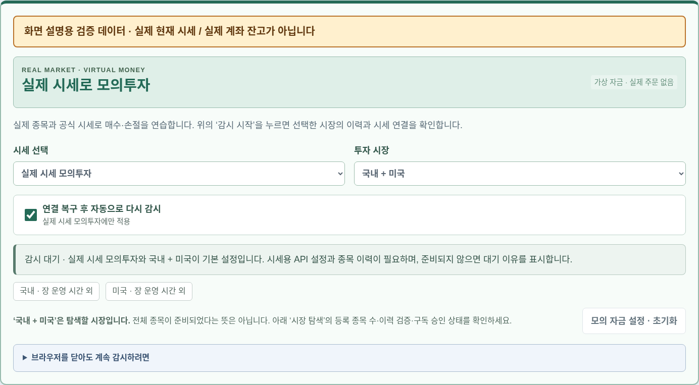
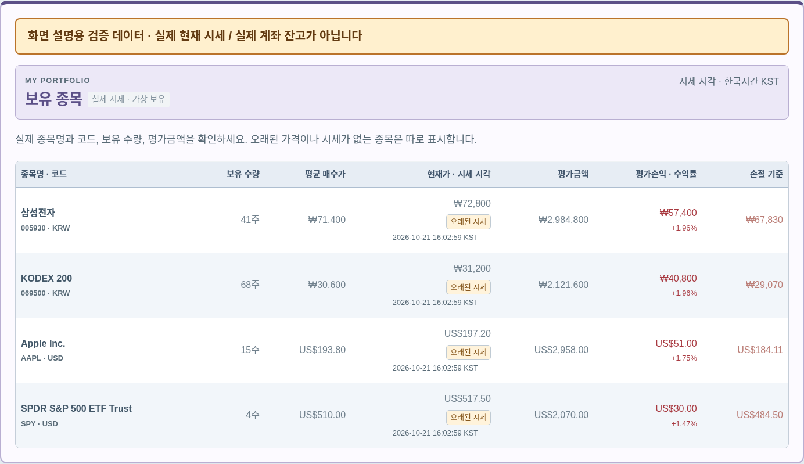
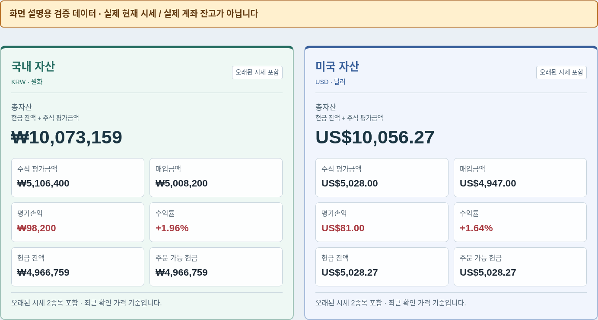
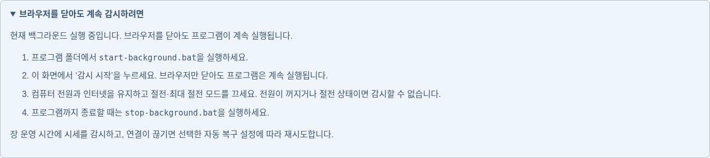

# 실행 화면으로 보는 사용법

아래 사진은 수정한 프로그램을 직접 실행해 캡처했습니다. **화면의 종목명은 실제 종목명이고, 가격·수량·체결은 기능 확인을 위한 검증용 입력입니다. 실제 현재 시세나 사용자 계좌의 투자 결과가 아닙니다.** 키움 API 인증과 실시간 시세 수신은 사용자 PC에서 키를 설정한 뒤 확인해야 합니다.

## 1. 업데이트하고 더블클릭으로 실행하기

1. 실행 중인 프로그램을 종료합니다. 검은 실행 창이 열려 있으면 그 창에서 **Ctrl+C**를 누릅니다. 이전에 백그라운드로 실행했다면 **stop-background.bat**을 더블클릭합니다.
2. [최신 프로그램 ZIP 다운로드](https://github.com/roy888682/kiwoom_buy_sell/archive/refs/heads/main.zip)를 눌러 다운로드합니다.
3. 다운로드한 ZIP을 마우스 오른쪽 버튼으로 눌러 **압축 풀기**를 선택합니다. 기존 프로그램 폴더와 다른 임시 위치에 풉니다.
4. 압축을 푼 폴더 안에서 `app`, `launch.py`, `start.bat` 등이 보이는 위치로 들어갑니다. **그 안의 파일과 폴더**를 모두 복사합니다.
5. 기존 `C:\Users\ykhan\Desktop\바이브코딩 작업목록\kiwoom_buy_sell-main` 폴더를 열어 붙여넣고, 같은 이름의 파일은 덮어씁니다. **기존 폴더를 삭제하지 마세요.** 기존 `.env`의 API 키, `data`의 거래 기록, `.venv` 설치 환경은 보존합니다. 다운로드 파일에 있는 `.env.example`은 입력한 키가 든 `.env`와 다른 파일입니다.
6. **start-background.bat**을 더블클릭합니다. 준비가 끝나면 Brave가 설치된 경우 Brave로 화면을 엽니다. 기존 브라우저 탭은 **Ctrl+Shift+R**로 새로고침합니다.

화면 파일 세 개만 덮어쓰는 이전 방법으로는 이번 기능을 사용할 수 없습니다. Python 프로그램과 새 실행 파일도 함께 업데이트해야 합니다.

## 2. 실제 시세 모의투자 선택하기

화면 위의 실행 모드는 **모의 거래**, 사진의 **시세 선택**은 **실제 시세 모의투자**로 맞춥니다. **국내 + 미국**을 선택하면 두 시장을 탐색합니다. 미국 시세 제공 권한을 아직 확인하지 못했다면 국내 시장부터 연결을 확인할 수 있습니다.

**감시 시작**을 누르면 종목 목록·가격 이력·실시간 구독을 준비합니다. 구독 승인과 최근 시세 시각을 확인하세요. 키가 없거나 데이터가 부족하면 오류 또는 대기 이유가 표시됩니다. 화면이 열렸다고 시세 연결까지 완료된 것은 아닙니다.

시작 현금을 바꾸려면 **모의 자금 설정 · 초기화**를 누릅니다. 해당 모의 장부의 기록을 지우는 기능이므로 이미 거래 중이라면 감시를 멈추고 사용합니다. 기본 가상 현금은 원화 1,000만 원과 달러 1만 달러입니다.

## 3. 종목별 보유 수량과 평가 확인하기

종목마다 **이름·코드, 정수 주수, 평균 매수가, 최근 가격과 시세 시각, 평가금액, 평가손익·수익률, 손절 기준**을 표시합니다.

사진의 삼성전자 검증 예시는 **41주 × 72,800원 = 평가금액 2,984,800원**입니다. 평균 매수가가 71,400원이므로 평가손익은 **57,400원**, 손절률 5%의 기준 가격은 **67,830원**입니다. 실제 계좌 보유 수량이 아니라 가상 예산으로 계산한 수량입니다.

사진은 검증용 시세를 저장한 뒤 서버를 다시 실행한 상태라 **오래된 시세** 표시가 있습니다. 최신 시세를 받기 전에는 저장 가격을 실시간 가격처럼 표시하지 않습니다. 시세를 전혀 확인할 수 없으면 `—`로 표시합니다.

## 4. 국내·미국 총 평가금액 확인하기

국내와 미국을 색깔과 테두리로 구분했습니다. **주식 평가금액**은 보유 주식의 평가 합계, **총자산**은 그 금액에 현금 잔액을 더한 값입니다.

사진에서 국내 주식 평가금액은 **5,106,400원**, 현금은 **4,966,759원**, 총자산은 **10,073,159원**입니다. 평가손익은 매입가격 대비 주가 차이이며 수수료를 뺀 순손익과 다릅니다. 현금에는 가정한 모의 수수료가 반영됩니다. 달러 금액은 원화로 환산해 합치지 않습니다.

## 5. 브라우저와 실행 창을 닫아도 계속 감시하기

**브라우저를 닫아도 계속 감시하려면**을 눌러 사진처럼 **현재 백그라운드 실행 중입니다**가 표시되는지 확인합니다. 이 실행 방식에서 브라우저를 닫은 뒤에도 서버가 정상 응답하는 것을 검증했습니다.

- **감시 시작** 후 브라우저를 닫아도 PC에서 감시가 계속됩니다.
- PC 전원·인터넷을 유지하고 절전·최대 절전은 꺼두세요. 화면만 꺼지는 것은 괜찮습니다.
- 다시 화면을 열 때는 **start-background.bat**, 프로그램까지 끌 때는 **stop-background.bat**을 더블클릭합니다.
- **연결 복구 후 자동으로 다시 감시**는 실제 시세 모의투자에만 적용합니다. 복구 대기 동안에는 매수·손절도 멈춥니다. 화면에서 **감시 중지**를 누르면 자동 복구 요청도 취소됩니다.
- GitHub에 저장했다고 24시간 실행되는 것은 아닙니다. PC를 끄고도 계속하려면 별도 상시 서버가 필요하며, 이번 작업에서 외부 서버에 배포하지 않았습니다.

Windows 로그인 시 자동 실행과 재시작 동작은 [백그라운드 실행 안내](background.md), API 키 입력은 [키움 연결 안내](kiwoom-connection.md), 모의 체결 가정은 [모의투자 안내](paper-trading.md)를 참고하세요.
